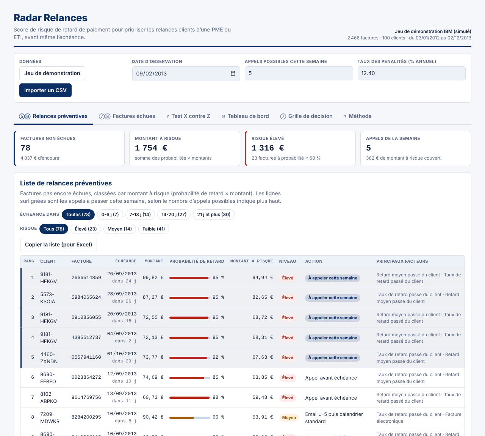
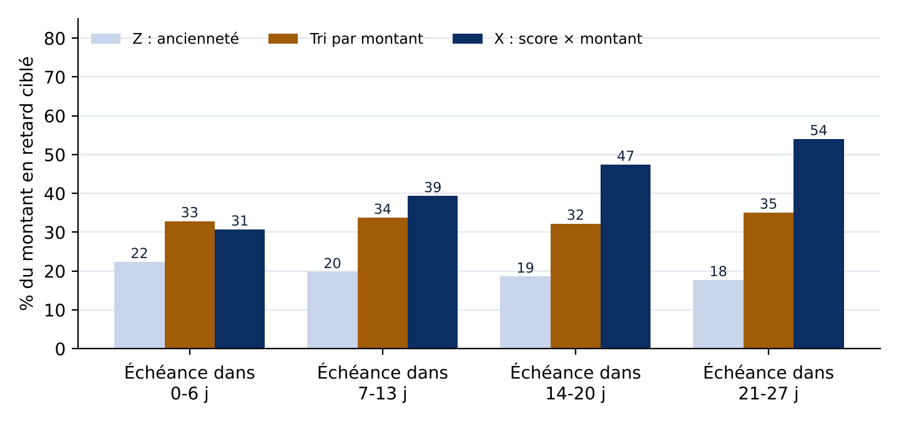

# Radar Relances

**Score de risque de retard de paiement pour prioriser les relances clients d'une PME ou ETI, avant même l'échéance.**

Projet de groupe du MSc Finance d'Entreprise & Ingénierie Financière (INSEEC MSc, M2, 2026-2027).



## Le problème

Dans la plupart des PME et ETI françaises, le credit manager exporte chaque semaine la balance âgée de l'ERP vers Excel. Il relance ensuite les factures **par ordre d'ancienneté**, et seulement **après l'échéance**. Il ne sait pas quelles factures risquent vraiment d'être payées en retard : son temps de relance, limité, est mal réparti.

Les retards de paiement augmentent de 25 % le risque de défaillance d'une entreprise (Observatoire des délais de paiement, rapport 2024).

## Question testée (format X / Y / Z)

> Un **score prédictif du risque de retard de paiement** (X) peut-il améliorer **le ciblage des relances clients**, mesuré par la part du montant des factures en retard détectée à nombre de relances égal (Y), **par rapport à la relance classée par ancienneté de la balance âgée** (Z) ?

## Résultats

Test sur 22 semaines (juillet à novembre 2013) et 421 factures du jeu IBM. Chaque semaine, on contacte 20 % des factures dont l'échéance tombe dans 14 à 20 jours :

| Méthode | Part du montant en retard ciblée |
|---|---|
| Z : ancienneté (workflow actuel) | 18,6 % |
| Tri simple par montant | 32,2 % |
| **X : score × montant (nouveau workflow)** | **47,4 %** |

- Gain contre l'ancienneté : **+28,8 points** (IC 95 % : +20,3 à +37,1).
- Gain contre le tri par montant : **+15,2 points** (IC 95 % : +6,6 à +24,2).
- Qualité du modèle sur 536 factures jamais vues : AUC 0,863, 81 % de bonnes prédictions (contre 71,8 % en prédisant « tout à l'heure »).



**Condition : agir tôt.** À moins d'une semaine de l'échéance, le score ne fait pas mieux qu'un tri par montant. Il ne reste alors presque que des factures qui seront payées en retard (76 %).

Sur le fichier `data/exemples/factures_clean.csv` (4 997 factures, 2025-2026), le score bat aussi largement l'ancienneté (+40,8 points). Mais il ne dépasse le tri par montant que de 1,9 point, car les montants y varient beaucoup plus.

## Utiliser l'application

L'application tient en un seul fichier, `index.html`, sans installation ni serveur. Les données importées ne quittent pas le navigateur.

1. Ouvrir `index.html` dans un navigateur, ou la version en ligne (voir « Publier avec GitHub Pages »). Le jeu de démonstration IBM est chargé au 02/09/2013.
2. **Relances préventives** : choisir la fenêtre « 14-20 j » et le nombre d'appels possibles. Les lignes surlignées sont les appels de la semaine ; le bouton « Copier la liste » permet de la coller dans Excel.
3. **Factures échues** : étape du calendrier de relance (J+7, J+14, J+21, J+28, mise en demeure vers J+35) et pénalités de retard, plus l'indemnité de 40 €.
4. **Test X contre Z** : refaire le test en changeant la fenêtre ou la capacité.
5. **Importer un CSV** : un export ERP avec une ligne par facture. Les colonnes sont détectées automatiquement, en français ou en anglais, avec `,` ou `;`, et des dates `jj/mm/aaaa` ou `aaaa-mm-jj`.

Colonnes obligatoires : client, date de facture, date d'échéance, montant, date de règlement (vide si la facture est ouverte). Colonnes facultatives : numéro de facture, litige, facture dématérialisée.

## Structure du dépôt

```
index.html                 Application complète (générée par app/build.py)
app/
  ui.html                  Interface (HTML, CSS, JavaScript)
  core.js                  Moteur : variables, régression logistique, test X contre Z
  build.py                 Assemble index.html
analysis/
  analysis.py              Analyse Python : modèles, test, boucle d'apprentissage
  horizons.py              Test X contre Z selon le moment du contact
  requirements.txt
data/
  ibm_accounts_receivable.csv   Jeu IBM « Accounts Receivable » (simulé), format d'origine
  demo_ibm.csv                  Même jeu, colonnes utiles, dates ISO (intégré à l'application)
  exemples/                     Fichiers de test aux intitulés et formats différents
results/                   Résultats chiffrés et graphiques
documents/                 Dossier de la séance 1, workflows, plan de travail, rapport final
tests/
  test_moteur.js           Vérifie que le moteur JavaScript redonne les résultats Python
  test_import.js           Vérifie la reconnaissance des colonnes sur tous les fichiers d'exemple
```

## Reproduire les résultats

```bash
# Analyse Python (environ 1 à 3 minutes)
pip install -r analysis/requirements.txt
cd analysis
python analysis.py      # modèles, test à 0-6 jours, boucle d'apprentissage
python horizons.py      # test selon le moment du contact
cd ..

# Contrôles (Node.js 18 ou plus)
node tests/test_moteur.js
node tests/test_import.js

# Régénérer l'application après une modification de app/ui.html ou app/core.js
python app/build.py
```

## Méthode en bref

- **Variables** : pour une facture observée à la date t, on utilise uniquement les factures du même client réglées avant t. Ces variables sont le taux et le retard moyen passés, les litiges passés, la dernière facture en retard, le montant, la facture dématérialisée et les autres factures ouvertes. Les taux sont lissés avec 3 factures fictives au taux moyen.
- **Modèle** : régression logistique L2, variables standardisées. Elle est retenue plutôt que le gradient boosting (AUC 0,850) car elle est aussi bonne, plus explicable et assez légère pour tourner dans le navigateur.
- **Aucune fuite d'information** : la date de règlement, le délai de règlement et le nombre de jours de retard de la facture prédite ne servent jamais à la prédire.
- **Niveaux de risque** : élevé (probabilité de 60 % ou plus), moyen (de 30 à 60 %), faible (moins de 30 %). Sur les factures de test, le taux de retard réel est de 71 %, 41 % et 10 %.
- **Test** : chaque lundi, les trois méthodes choisissent le même nombre de factures. Les intervalles de confiance sont calculés par rééchantillonnage des semaines.

Le détail complet est dans `documents/Rapport_Radar_Relances.docx`.

## Limites

- Les données sont simulées : les résultats devront être confirmés sur des données réelles d'entreprise.
- Le test mesure le ciblage, pas l'effet réel d'un appel sur le paiement. L'effet sur le DSO (environ −0,9 jour contre −0,2 jour pour l'ancienneté) repose sur une hypothèse : un contact réduirait le retard de moitié.
- Le score repose surtout sur l'historique du client : il est peu informatif pour un nouveau client.
- Dans le jeu IBM, les montants sont en dollars ; ils sont affichés en euros pour l'exemple.
- Des logiciels proposent déjà la relance automatisée, parfois avec un score. L'intérêt du projet est une solution simple, transparente et gratuite pour une PME.

## Publier avec GitHub Pages

Settings → Pages → Source : « Deploy from a branch », branche `main`, dossier `/ (root)`. L'application est ensuite en ligne à l'adresse `https://<compte>.github.io/radar-relances/`.

## Équipe

| Membre | Rôle |
|---|---|
| Raphaël KOTOR | à compléter |
| à compléter | à compléter |
| à compléter | à compléter |
| à compléter | à compléter |
| à compléter | à compléter |
| à compléter | à compléter |

## Sources

- Jeu de données IBM Watson « Accounts Receivable » (simulé), via le package R [data1135](https://github.com/bcBusinessStats/data1135)
- [Optimize Cash Collection: Use Machine Learning to Predict Invoice Payment](https://arxiv.org/abs/1912.10828) (arXiv, 2019)
- [Service Public Entreprendre — Recouvrement amiable](https://entreprendre.service-public.gouv.fr/vosdroits/F38586)
- [Sage — Guide des procédures de relance](https://www.sage.com/fr-fr/blog/wp-content/uploads/sites/4/2022/05/guide-quelles-procedures-de-relances-pour-etre-paye-rapidement-src-2022-05.pdf)
- [Sénat — Proposition de loi sur les retards de paiement](https://www.senat.fr/leg/ppl25-083.pdf) (chiffres de l'Observatoire des délais de paiement)
